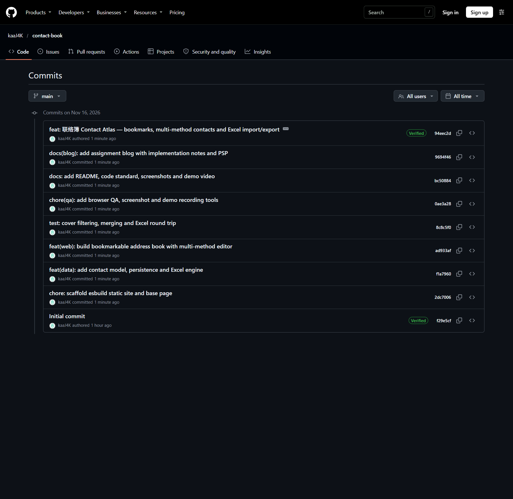
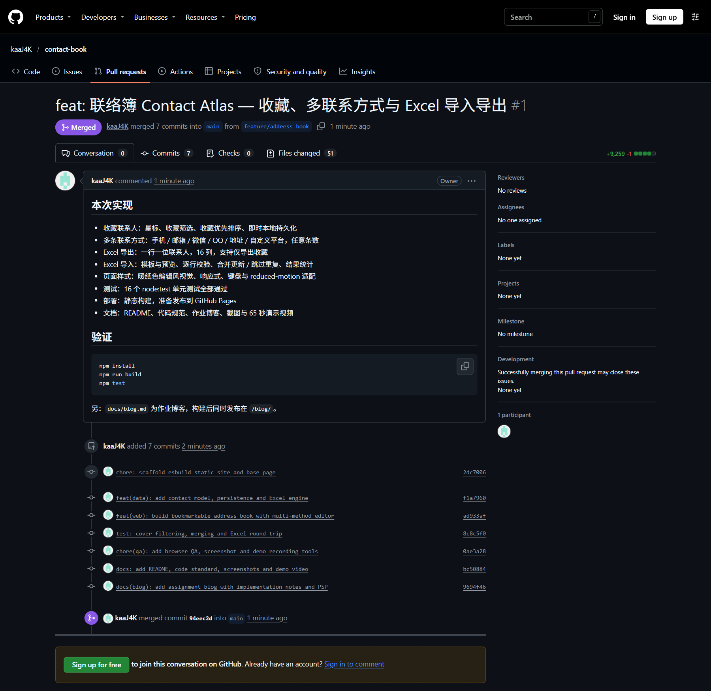
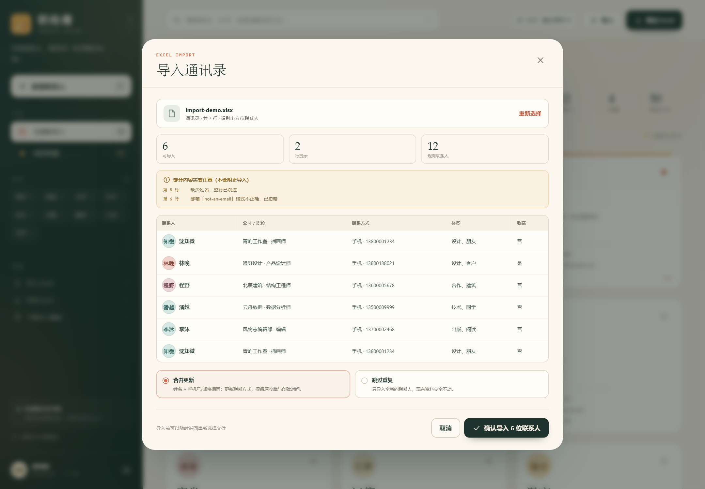
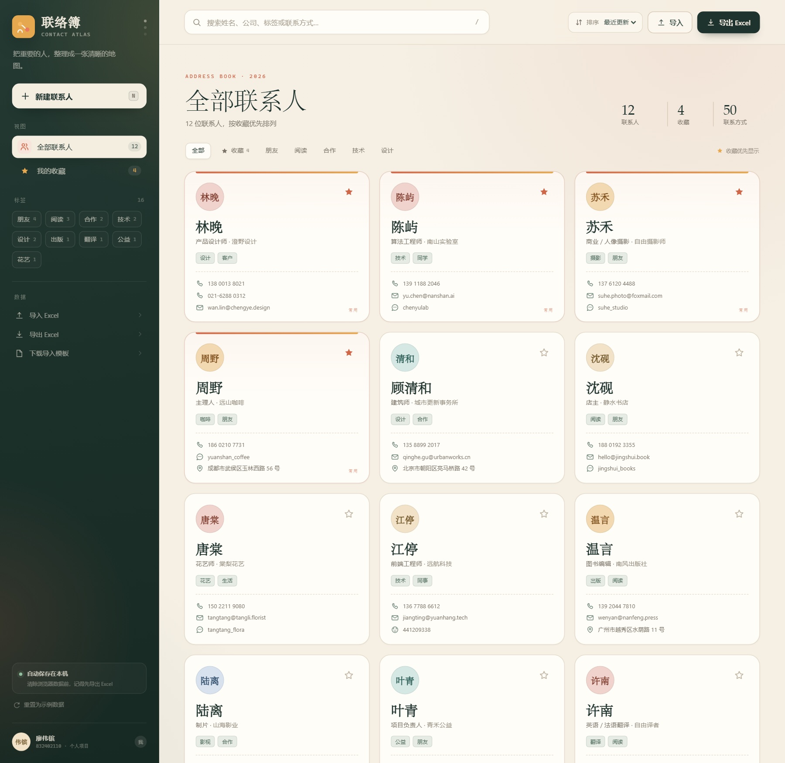

# 软件工程个人编程作业：联络簿 Contact Atlas（收藏 / 多联系方式 / Excel 导入导出）

## 作业说明

| 项目 | 内容 |
| --- | --- |
| 所属课程 | 软件工程（FZU-MU） |
| 作业布置位置 | 课程 CSDN 社区「Programming Assignment — Address Book / 通讯录」作业帖 |
| 团队 / 个人 | 个人项目（Individual Project） |
| 姓名 / 学号 | 廖伟镔 / 832402110 |
| 本次作业目标 | 实现一个可用的地址簿 Web 程序：收藏联系人、单人多条联系方式、Excel 导入导出，并发布到云端、完成博客与演示视频 |
| 项目仓库 | <https://github.com/kaaJ4K/contact-book> |
| 在线应用 | <https://kaaj4k.github.io/contact-book/> |
| 在线博客 | <https://kaaj4k.github.io/contact-book/blog/> |
| 参考资料 | [MDN Web Docs](https://developer.mozilla.org/)、[React 官方文档](https://react.dev/)、[SheetJS / xlsx-js-style](https://github.com/gitbrent/xlsx-js-style)、Google HTML/CSS/JS Style Guide、Airbnb JavaScript Style Guide |

## 目录

1. [作业说明](#作业说明)
2. [项目地址与快速开始](#一项目地址与快速开始)
3. [需求拆解与完成情况](#二需求拆解与完成情况)
4. [Git 协作与提交记录](#三git-协作与提交记录)
5. [功能实现思路](#四功能实现思路)
6. [程序截图](#五程序截图)
7. [运行视频](#六运行视频)
8. [云端部署](#七云端部署)
9. [分工与贡献比](#八分工与贡献比)
10. [困难、尝试与收获](#九困难尝试与收获)
11. [PSP 表](#十psp-表)
12. [评分项自查](#十一评分项自查)
13. [提交前检查清单](#十二提交前检查清单)

---

## 一、项目地址与快速开始

| 类型 | 链接 |
| --- | --- |
| GitHub 仓库 | <https://github.com/kaaJ4K/contact-book> |
| 在线体验（GitHub Pages） | <https://kaaj4k.github.io/contact-book/> |
| 博客在线版 | <https://kaaj4k.github.io/contact-book/blog/> |
| 代码规范 | <https://github.com/kaaJ4K/contact-book/blob/main/codestyle.md> |
| Pull Request（功能分支 → main） | <https://github.com/kaaJ4K/contact-book/pull/1> |
| Release v1.0.0 | <https://github.com/kaaJ4K/contact-book/releases/tag/v1.0.0> |
| 演示视频 | [docs/demo.mp4](https://github.com/kaaJ4K/contact-book/blob/main/docs/demo.mp4) |
| 导入示例 / 导出示例 | [import-demo.xlsx](https://github.com/kaaJ4K/contact-book/blob/main/docs/samples/import-demo.xlsx) / [export-demo.xlsx](https://github.com/kaaJ4K/contact-book/blob/main/docs/samples/export-demo.xlsx) |

本地运行：

```bash
git clone https://github.com/kaaJ4K/contact-book.git
cd contact-book
npm install
npm run build
npm run preview     # http://127.0.0.1:4173
npm test            # 16 个单元测试
```

技术栈：React 18 + 原生 CSS + esbuild；Excel 读写使用 `xlsx-js-style`；数据保存在浏览器 `localStorage`，应用本身构建为纯静态站点，无后端依赖。

## 二、需求拆解与完成情况

| 作业要求 | 分值 | 完成情况 | 证据 |
| --- | --- | --- | --- |
| 收藏联系人 | 25 | 星标收藏/取消；收藏筛选；收藏优先排序；即时持久化 | 截图 1、2；`src/components/ContactCard.jsx`、`src/lib/contacts.js` |
| 添加多个联系方式 | 10 | 手机、邮箱、微信、QQ、地址、自定义平台均可添加任意多条，支持删除和复制 | 截图 3、4；`src/components/ContactEditor.jsx`、`src/components/ContactDetail.jsx` |
| Excel 导出 | 25（与导入合计） | 每个联系人一行，16 种信息列；支持仅导出收藏；带样式和自动筛选 | 截图 7；`src/lib/excel.js`、`docs/samples/export-demo.xlsx` |
| Excel 导入 | 同上 | 模板下载、拖拽上传、表头别名、预览、逐行校验、合并更新/跳过重复、导入结果统计 | 截图 5、6；`src/components/ImportDialog.jsx` |
| 页面样式 | 10 | 暖纸色 + 深森林绿设计；响应式侧栏/卡片/弹窗；键盘可访问与 reduced-motion 适配 | 截图 1–10 |
| 云端部署（可选） | +15 | GitHub Pages 公共云托管，公网可直接访问 | <https://kaaj4k.github.io/contact-book/> |
| 附加能力 | — | 全局搜索、标签筛选、三种排序、删除撤销、键盘快捷键、移动端悬浮新建、自动保存状态提示 | 见下文 |

### 功能清单

- **收藏联系人**：卡片右上角星标；侧栏「我的收藏」；收藏优先分区；收藏状态修改后立即写入本机存储。
- **多条联系方式**：每位联系人可添加任意多条；每条可切换类型（手机 / 邮箱 / 微信 / QQ / 地址 / 其他），其他类型可填写平台名（如 GitHub、小红书）；详情页逐条复制。
- **Excel 导出**：16 列；超过预留列的多手机号/多邮箱自动折叠进最后一列并以 ` / ` 分隔；再次导入自动还原，不丢数据；可选仅导出收藏。
- **Excel 导入**：`.xlsx` / `.xlsm`，最大 8 MB、2000 行；自动识别中文/英文表头；姓名必填；非法邮箱、过短电话、缺少姓名等给出行号提示；提供「合并更新」「跳过重复」两种策略。
- **体验细节**：搜索姓名、公司、职位、标签、备注和所有联系方式；生日与标签筛选；删除后 8 秒内可撤销；首次加载 12 位示例联系人，可一键重置。

## 三、Git 协作与提交记录

本作业为个人项目，没有队友协作；仓库由本人从零建立，并采用功能分支 + Pull Request 的合并流程，保证提交历史清晰可追溯。






提交统计（截至截图时）：`main` 分支共 **9 个提交**（含 1 个 merge commit）；GitHub Contributors 页面显示 **kaaJ4K — 8 commits**（GitHub 的贡献统计不含 merge commit），仓库仅本人 1 位贡献者。截图之后新增的文档提交可在仓库的 Commits 页面查看。

提交记录（主要节点）：

```text
chore: scaffold esbuild static site and base page
feat(data): add contact model, persistence and Excel engine
feat(web): build bookmarkable address book with multi-method editor
test: cover filtering, merging and Excel round trip
chore(qa): add browser QA, screenshot and demo recording tools
docs: add README, code standard, screenshots and demo video
docs(blog): add assignment blog with implementation notes and PSP
feat: 联络簿 Contact Atlas — bookmarks, multi-method contacts and Excel import/export   # PR merge
```

- 分支策略：`feature/address-book` 开发 → Pull Request → 合并 `main`。
- 版本：`v1.0.0` Release，Release notes 中附在线体验与视频链接。
- 提交规范：`type(scope): summary`，详见 [codestyle.md](https://github.com/kaaJ4K/contact-book/blob/main/codestyle.md)。

> 说明：若课程要求先 Fork 教师/助教提供的模板仓库，可先 Fork 模板，再将本仓库提交历史与代码同步到 Fork 仓库；本项目为个人从零实现，故直接在个人仓库完成分支与 PR 流程。

## 四、功能实现思路

### 4.1 总体架构

```text
┌──────────────────────────────────────────────────────────┐
│                      React 单页应用                        │
│  App.jsx：筛选 / 排序 / 弹窗状态 / 导入导出入口              │
│  components：侧栏、联系人卡片、详情抽屉、编辑器、导入导出弹窗  │
├──────────────────────────────────────────────────────────┤
│  lib/contacts.js        数据模型、校验、搜索、收藏排序、合并   │
│  lib/excel.js           表头映射、解析、校验、工作簿生成       │
│  lib/storage.js         localStorage 读写、重置              │
│  data/seed.js           12 位示例联系人                      │
├──────────────────────────────────────────────────────────┤
│  localStorage（唯一数据源，无服务端）                         │
└──────────────────────────────────────────────────────────┘
```

实现上刻意保持「数据层纯函数 + UI 薄层」：所有筛选、排序、合并、校验都可以在 Node 中单独测试，React 组件只负责展示和事件绑定。这样既能保证 16 个单元测试的覆盖率，也方便后续替换存储方式。

### 4.2 数据模型

```js
contact = {
  id, name, company, title, birthday, tags: [], favorite, note,
  methods: [
    { id, type: 'phone' | 'email' | 'wechat' | 'qq' | 'address' | 'other', label, value }
  ],
  createdAt, updatedAt,
}
```

一个联系人对应一个 `contact`，联系方式是独立的数组。选择这种一对多结构，而不是「phone1/phone2/email1」的固定字段，原因是：

1. UI 可以无上限地增加任意类型、任意数量的联系方式；
2. Excel 导出时再映射成固定列，不符合列数的内容折叠保存，兼顾表格可读性和数据完整性；
3. 合并导入时只替换联系方式数组，不会误改 `favorite`、`createdAt` 等账户内状态。

### 4.3 收藏联系人

- 星标按钮更新 `favorite`，并同步更新 `updatedAt`；
- `filterAndSort()` 在所有视图中执行 `sort((a, b) => Number(b.favorite) - Number(a.favorite))`，保证收藏始终优先；
- 侧栏「我的收藏」与顶部收藏筛选保持同一份 `scope` 状态，不维护重复列表；
- 所有状态修改后 `App` 的 `useEffect` 自动调用 `saveBook()`，无需手动保存按钮。

### 4.4 多条联系方式

- 编辑器用一组动态行渲染 `methods`，每行可选类型、输入内容、删除；
- 类型为「其他」时额外显示平台名输入，用于 GitHub、小红书、作品集等；
- 校验规则：姓名必填；邮箱需符合基本格式；电话至少 5 位数字；同一联系人内同类型同值去重；
- 详情抽屉按类型着色展示，并支持逐条复制到剪贴板。

### 4.5 Excel 导出设计

导出列固定为 16 列：

```text
姓名 | 公司 | 职位 | 生日 | 标签 | 收藏 | 手机1 | 手机2 | 手机3 | 邮箱1 | 邮箱2 | 微信 | QQ | 地址 | 其他 | 备注
```

关键处理：

1. **一行一人、一列一类信息**；
2. 多手机号超过 3 个时，第 3 列折叠为 `p3 / p4 / p5`；多邮箱超过 2 个同理；导入时按分隔符还原成多条；
3. 「其他」列使用 `平台: 账号` 格式，多个条目换行；
4. 导出时对以 `= + - @` 开头的字符串加 `'` 前缀，防止 Excel 公式注入，导入时再剥离；
5. 工作簿设置表头颜色、加粗、列宽、隔行底色和自动筛选，导出的文件可以直接交付/归档；
6. 支持「仅导出收藏」，方便做常用联系人精简备份。

### 4.6 Excel 导入流程

```text
选择/拖入文件
   ↓
扩展名、大小、行数校验
   ↓
xlsx 解析 → 在前 10 行内查找表头 → 中英文别名映射
   ↓
逐行解析：姓名、标签、收藏、手机/邮箱/微信/QQ/地址/其他
   ↓
行级错误收集（不阻断其它行） → 预览表 + 统计
   ↓
选择「合并更新」或「跳过重复」
   ↓
按「姓名 + 手机号/邮箱」判断重复 → 一次性写入 → 展示新增/更新/跳过/提示
```

重复判断规则：姓名相同，且至少有一个手机号或邮箱相同；只有双方都没有手机/邮箱时才按姓名匹配。这样避免同名不同人误合并。合并模式保留原有的收藏状态、创建时间，并合并标签；跳过模式完全不动已有联系人。

### 4.7 页面设计与响应式

- 设计概念：「联络簿」是一张温暖的纸质名片夹，深森林绿侧栏 + 暖米色纸面 + 珊瑚色收藏高亮；
- 字体：标题用衬线字体形成编辑感，正文用无衬线保证中文可读性；
- 设计令牌统一颜色、间距、圆角、阴影；卡片 hover 轻微上浮，弹窗/抽屉有节制的过渡；
- 响应式：>980 px 固定侧栏；≤980 px 侧栏变为抽屉；≤760 px 卡片单列、筛选横向滚动、弹窗底部对齐；
- 可访问性：纯图标按钮均有 `aria-label`，弹窗 `role="dialog"`，支持 Escape 关闭，`:focus-visible` 有可见焦点环，`prefers-reduced-motion` 下关闭动画。

### 4.8 测试与质量

`npm test` 使用 Node 原生 `node:test`，共 16 个测试全部通过，覆盖：

- 数据规范化、必填校验、重复联系方式校验；
- 全文搜索、标签筛选、收藏优先排序；
- 重复联系人判断与合并/跳过两种导入模式；
- Excel 列结构、多手机/多邮箱折叠与还原、自定义平台标签往返；
- 模板回读、英文表头别名、标题行下方表头识别；
- 缺少姓名/非法邮箱行提示、无姓名列报错、公式注入转义。

```text
✔ tests 16
✔ pass 16
✔ fail 0
```

## 五、程序截图

| 主界面：全部联系人 | 我的收藏 |
| --- | --- |
|  |  |

| 联系人详情：多条联系方式 | 编辑器：多个联系方式与标签 |
| --- | --- |
|  |  |

| Excel 导入预览与校验提示 | 导入结果统计 |
| --- | --- |
|  |  |

| 导出 Excel | 搜索与筛选 |
| --- | --- |
|  |  |

| 移动端首页 | 移动端侧栏 |
| --- | --- |
|  |  |

> 图标、示例联系人与界面均由本项目自行设计与实现；示例数据用于展示功能，不代表真实个人信息。

## 六、运行视频

- **在线视频**：<https://kaaj4k.github.io/contact-book/blog/demo.mp4>
- **仓库文件**：[docs/demo.mp4](https://github.com/kaaJ4K/contact-book/blob/main/docs/demo.mp4)
- **时长 / 内容**：约 65 秒，覆盖收藏筛选、多联系方式编辑、新建联系人、Excel 导入预览与结果、导出弹窗、搜索、移动端视图。
- 如果课程平台要求视频上传，可直接使用仓库中的 `docs/demo.mp4`；CSDN / 哔哩哔哩等平台上传后把链接补充到本节即可。

<video controls preload="metadata" poster="images/video-poster.jpg" src="demo.mp4"></video>

[](https://kaaj4k.github.io/contact-book/blog/demo.mp4)

## 七、云端部署

应用是纯静态单页应用，构建后直接部署到 **GitHub Pages**：

1. `npm run build` 生成 `dist/`；
2. 将 `dist/` 内容发布到仓库的 `gh-pages` 分支；
3. 仓库 Settings → Pages → Deploy from a branch → `gh-pages / (root)`；
4. 公网地址：<https://kaaj4k.github.io/contact-book/>。

这不是 localhost，也不依赖运行者电脑：任何设备打开公网地址即可使用；数据保存在各自浏览器，第一次打开自动载入示例联系人。



## 八、分工与贡献比

本作业为**个人项目**，没有团队成员。

| 姓名 | 学号 | 工作描述 | 贡献比 |
| --- | --- | --- | --- |
| 廖伟镔 | 832402110 | 需求拆解、UI/交互设计、数据模型、收藏与多联系方式、Excel 导入导出、测试、云端部署、博客与视频 | 100% |
| **合计** | — | — | **100%** |

## 九、困难、尝试与收获

### 困难 1：固定 Excel 列与「任意多条联系方式」天然冲突

- **困难描述**：需求要求每种信息占一列，但应用允许同一个人有任意多条手机号/邮箱；简单截断会丢数据。
- **解决尝试**：先固定列模板，再设计「折叠 + 还原」规则：超出预留列的值合并到该类型最后一列，用分隔符保存；导入时按分隔符拆开。配合 `contactToRow()` / `parseImportBuffer()` 往返测试，验证 4 个手机号、3 个邮箱、多条地址都能无损恢复。
- **是否解决**：已解决。单元测试覆盖折叠与还原。
- **收获**：表格格式不是数据模型的限制条件，设计好映射规则就能兼顾可读性和完整性。

### 困难 2：导入的重复联系人、错误行和用户预期不一致

- **困难描述**：真实 Excel 容易出现姓名缺失、邮箱格式错误、同一文件内重复行；如果遇到一行错误就整体失败，体验很差。
- **解决尝试**：把导入改造成「解析 → 预览 → 确认」三段式；行级错误单独收集并显示行号；提供「合并更新」「跳过重复」两种模式；用「姓名 + 手机号/邮箱」判断重复，避免同名误合并；导入结束后显示新增/更新/跳过/提示四项统计。
- **是否解决**：已解决。示例文件 `import-demo.xlsx` 能稳定产生 4 新增 / 2 更新 / 2 提示，预演了真实场景。
- **收获**：导入功能的核心不是「读文件」，而是把不可控的外部数据变成用户可预期、可撤销的操作。

### 困难 3：本地优先数据存储的可靠性与用户信任

- **困难描述**：没有后端，数据只存在浏览器；用户可能清理浏览器数据或换设备，造成丢失。
- **解决尝试**：所有修改即时写入 `localStorage`；页脚持续显示「自动保存在本机」；侧栏提供「导出 Excel」作为迁移/备份路径；删除操作提供 8 秒撤销；首次使用提供示例数据并说明可重置。
- **是否解决**：已解决。数据可导出，关键操作有提示和撤销。
- **收获**：本地优先并不等于「不负责」，需要把备份与恢复能力作为功能的一部分。

### 困难 4：静态部署与视觉、可访问性的平衡

- **困难描述**：无后端部署简单，但要保证任何设备打开都正常，还要让页面有辨识度；弹窗、卡片、移动端交互容易顾此失彼。
- **解决尝试**：使用相对资源路径（`base: './'`）兼容 GitHub Pages 子路径；用设计令牌统一颜色和间距；对每个断点做截图验收；给纯图标按钮补 `aria-label`、支持 Escape 关闭、处理 reduced-motion。
- **是否解决**：已解决。桌面和 390 px 移动端均完成实机截图验证。
- **收获**：样式不是最后「刷一层颜色」，设计约束越早建立，后面加功能越省力。

### 困难 5：个人项目中如何保证交付质量

- **困难描述**：没有队友 review，容易在最后阶段才发现导入、导出或移动端问题。
- **解决尝试**：先写数据层纯函数和测试，再做 UI；用 Node + CDP 写自动化浏览器验收脚本，自动走完收藏、CRUD、导入、导出和移动端流程；把 demo 视频与截图也纳入脚本生成，减少手工遗漏。
- **是否解决**：已解决。`tools/capture.mjs` 和 `tools/record.mjs` 可重复生成截图/视频。
- **收获**：自动化不仅服务于测试，也能稳定生产交付物。

## 十、PSP 表

| 阶段 | 计划时间（h） | 实际时间（h） | 实际 / 计划 | 说明 |
| --- | ---: | ---: | ---: | --- |
| 需求分析与任务拆解 | 2.0 | 2.0 | 100% | 拆分收藏、多联系方式、Excel、部署和博客 |
| 技术选型与项目搭建 | 1.0 | 1.0 | 100% | React + esbuild + xlsx-js-style；评估静态部署可行性 |
| 数据模型与本地存储 | 2.0 | 2.5 | 125% | 联系方式一对多模型、合并规则、localStorage 容错 |
| 收藏与多联系方式功能 | 5.0 | 6.0 | 120% | 卡片、详情抽屉、编辑器、校验与交互细节 |
| Excel 导入导出 | 6.0 | 8.0 | 133% | 列映射、折叠还原、导入预览、错误提示、样式 |
| 页面样式与响应式 | 3.0 | 3.5 | 117% | 设计令牌、动效、移动端、可访问性 |
| 测试与缺陷修复 | 2.0 | 2.5 | 125% | 16 个单元测试、自动化浏览器验收 |
| 云端部署与验收 | 2.0 | 2.0 | 100% | GitHub Pages、截图、公网检查 |
| 博客、截图与演示视频 | 3.0 | 2.5 | 83% | Markdown 博客、10 张截图、65 秒视频 |
| **合计** | **26.0** | **30.0** | **115%** | 主要超支在 Excel 映射与导入校验 |

## 十一、评分项自查

| 评分项 | 分值 | 自查结果 | 对应证据 |
| --- | ---: | --- | --- |
| 博客格式 Markdown | 10 | ✅ 使用 Markdown；含仓库、部署、代码规范、PR、Release 链接 | 本文；`codestyle.md` |
| 功能实现思路、截图、分工 | 20 | ✅ 架构、数据模型、Excel 映射、测试思路齐全；10 张真实截图；个人贡献 100% | 本文第四、五、八节 |
| 页面样式 | 10 | ✅ 统一设计语言、响应式、可访问性细节 | 截图 1–10 |
| 收藏联系人 | 25 | ✅ 星标、收藏筛选、收藏优先、持久化 | 截图 1、2 |
| 添加多个联系方式 | 10 | ✅ 任意多条六种类型、自定义平台、编辑/删除/复制 | 截图 3、4；测试 |
| 导入和导出 | 25 | ✅ Excel 导入导出闭环、模板、预览、校验、合并/跳过 | 截图 5–7；示例 xlsx；测试 |
| Web 云端部署（额外） | +15 | ✅ GitHub Pages 公网可访问，非 localhost | 应用地址；截图 live-site |
| **基础合计** | **100** | — | — |
| **含可选加分** | **115** | — | — |

## 十二、提交前检查清单

- [x] GitHub 仓库建立，提交次数 ≥ 3，功能分支与 PR 流程完整
- [x] 代码可构建（`npm install && npm run build`），测试通过（`npm test`）
- [x] 基础功能：收藏联系人、多条联系方式、Excel 导入导出
- [x] 页面样式：桌面与移动端截图
- [x] 公网部署：GitHub Pages 链接可用（非 localhost）
- [x] 博客包含作业说明表、目录、项目地址、功能实现思路、截图、分工/贡献比、困难与解决、PSP 表
- [x] 演示视频已录制并提交到仓库 / 在线博客
- [ ] 课程平台要求的具体博客发布位置（CSDN 等）按课程通知发布；如需要，可直接复制本文 Markdown 与 `images/`、`demo.mp4` 上传
- [ ] 若课程要求 Fork 模板仓库，请按课程通知完成 Fork 并在博客中替换为 Fork 后的仓库地址

---

**项目总结**：这次作业最大的收获不是写出某个具体页面，而是学会先把需求翻译成可测试的数据模型，再用可重复的构建、测试和截图流程保证交付质量。收藏、多条联系方式与 Excel 导入导出看似是三个独立需求，实际上都围绕「如何表示一个人」这个核心建模问题展开；把模型定清楚，后面的 UI 与文件格式都只是映射。
